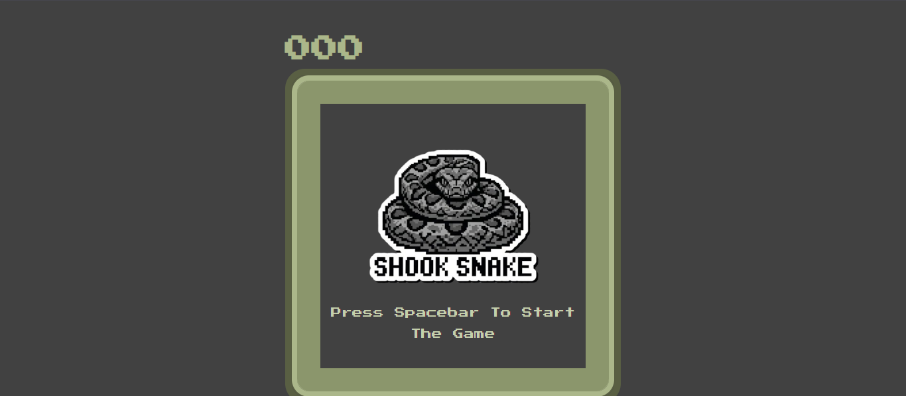
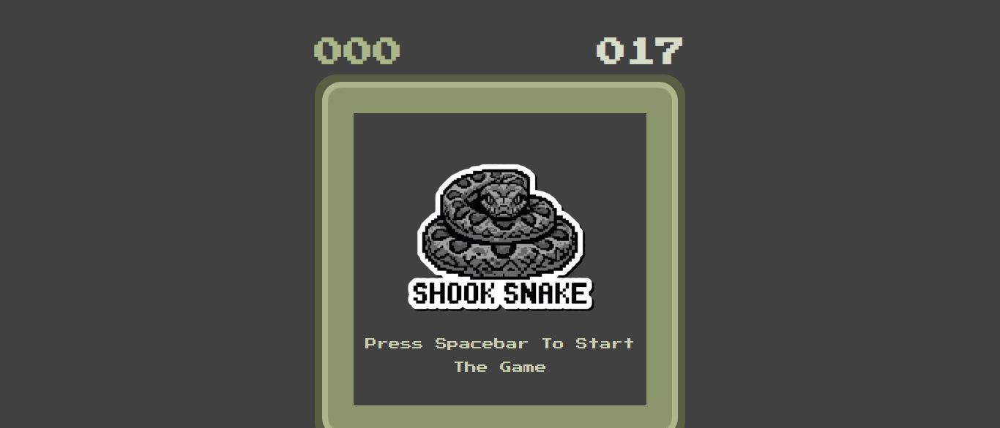
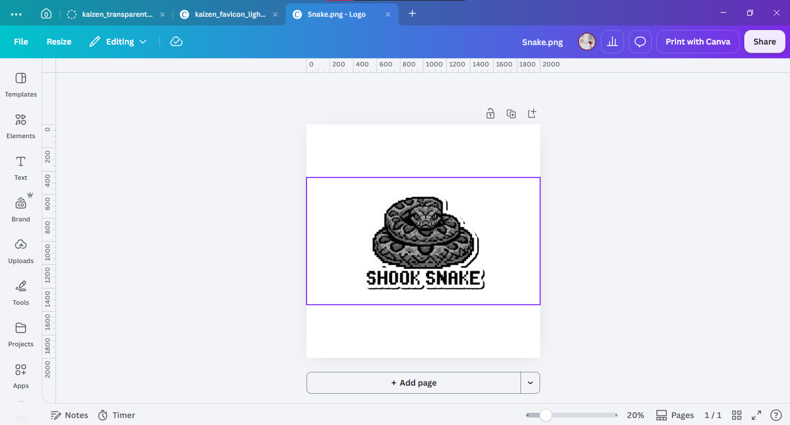

# Shook Snake !!

### just a snake tryin not to die

hey! I'm Adnan, and i made a snake game because just sitting down and waiting for you past two projects get passed t2 isn't that fun

It's called **Shook Snake**, a retro style snake game I made using HTML, CSS,  and Javascript.

nothing groundbreaking, just the classic nokia snake game with a little pixel art aesthetic.. and yes, the snake will die if you hit a wall (skill issue).

**Live Demo**: [shooksnake.xyz](https://shooksnake.xyz/)


## What Even It is?

it's snake, literally.

I made it for [embassy.hackclub.com](https://embassy.hackclub.com/) to cure my impatiency.

you control a little snake using your arrow keys, collect food, grow longer and try not to crash into walls or yourself.

the longer you survive, the higher the score gets. the game also gets faster as you eat more food, so good luck with that.

### FEATURES!

- retro pixel art design inspired by old arcades, asm I'm a big fan of GBA and GBC!
- keyboard controls using arrow keys
- food that randomly spawns around the board
- snake goes longer after eating
- increase of speed with progress 
- wall and self collision detection
- score and high score tracking 
- restart the game by pressing spacebar

## Screenshots










## How did I make this?

i made this using   

-**HTML**
-**CSS**
-**JAVASCRIPT**
-**GoogleFontAPI**

no frameworks, no complicated libraries, just Plain HTML, CSS and JS.

i was learning JavaScript and wanted to build something that actually worked instead of just staring at tutorials all day.

so, snake game it was!

### THE STRUGGLES :(

okay, making the snake move was fun, but debugging? not so much.

i had a bunch of issues while making this.

the snake was practically invisible at one point because its colour matched the background.

the instructions kept overlapping with the logo, and fixing one thing somehow managed to break another.

and then there was the collision bug.

the snake would hit the wall and just... stay there. turns out, i'd written `highscore` in HTML but `highScore` in JavaScript.

one capital letter. hundreds of console errors.

lovely.

but hey, i learnt quite a bit about DOM manipulation, arrays, functions, events, intervals and debugging along the way.


## HOW TO PLAY?

1. Open [Shook Snake](https://shooksnake.xyz/).
2. Press **Spacebar** to start.
3. Use the **Arrow Keys** to control your snake.
4. Eat food and grow longer.
5. Avoid crashing into walls or yourself.
6. Try beating your high score!

that's literally it.


## RUN IT LOCALLY!!


wanna try it yourself?

1. Clone the repository:
   ```bash
   git clone https://github.com/really4adnan/ShookSnake.git

2. Open the project folder and launch index.html in your browser.

that's it! no installations, no dependencies, just snake. 🐍  


## AI DISCLOSURE

AI was used for debugging errors and troubleshooting issues during development.


## Before anyone ask why I am telling that much things, i read the Guide of README.md from Phantom ysws web and decided to follow that..

**anyways, thanks for checking this out**

**don't hit the walls!**